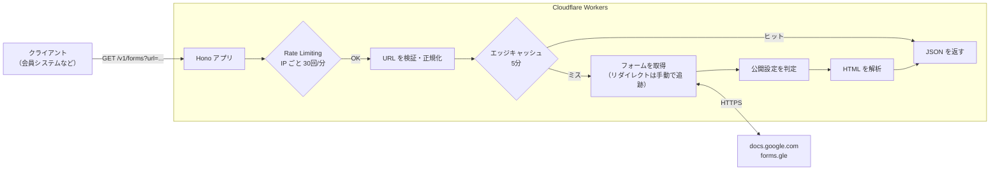
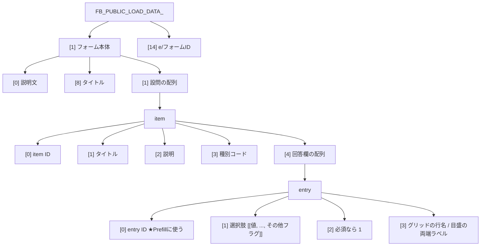
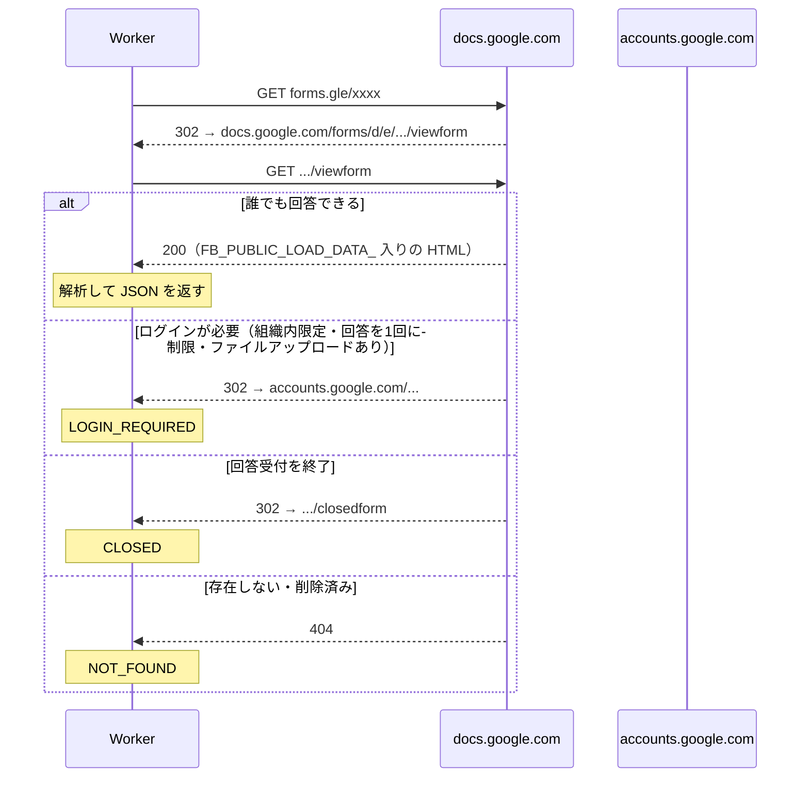
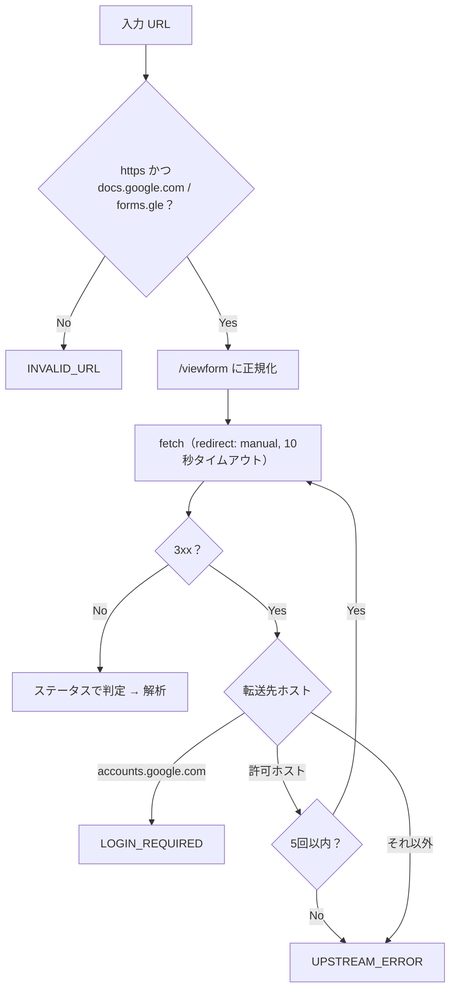
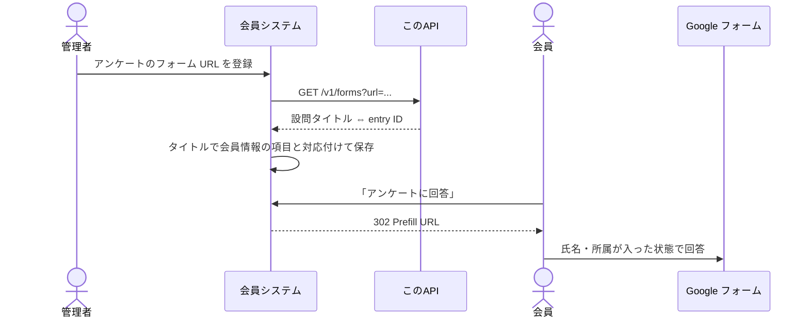

# Google フォームの URL を投げると設問と entry ID を JSON で返す API を Cloudflare Workers で作った

## はじめに

Google フォームには、URL のクエリで回答をあらかじめ埋めておく **Prefill** 機能があります。

```
https://docs.google.com/forms/d/e/<フォームID>/viewform?usp=pp_url&entry.1234567890=山田太郎
```

自前の会員システムから「ログイン中のユーザーの氏名・所属を埋めた状態でアンケートを開く」といったことができて便利です。ただし、そのためには **設問ごとの `entry.xxxxx` の ID** を知っている必要があります。

フォームの編集画面の「事前入力した URL を取得」から 1 つずつ調べることもできますが、フォームを作るたびにこれをやるのは面倒です。そこで

> **フォームの URL を渡すと「設問タイトル ⇔ entry ID」の対応を JSON で返す API**

を Cloudflare Workers + Hono で作り、誰でも使える API として公開しました。

## 作ったもの

```
GET  /v1/forms?url=<Google フォームの URL>
POST /v1/forms   {"url": "<Google フォームの URL>"}
```

`viewform` の URL だけでなく、`forms.gle` の短縮 URL や編集画面の `/edit` URL も受け付けます。

```bash
curl "https://googleforms-api.googleformparser.workers.dev/v1/forms?url=https://forms.gle/xxxxxxxx"
```

```json
{
  "form_url": "https://docs.google.com/forms/d/e/1FAIpQL.../viewform",
  "form_id": "1FAIpQL...",
  "title": "講習会アンケート",
  "description": "ご参加ありがとうございました",
  "items": [
    {
      "item_id": "111",
      "title": "氏名",
      "description": null,
      "type": "short_answer",
      "type_code": 0,
      "entries": [{ "entry_id": "1001", "label": null, "required": true }],
      "options": [],
      "has_other_option": false,
      "scale_labels": null
    },
    {
      "item_id": "222",
      "title": "学年",
      "description": null,
      "type": "multiple_choice",
      "type_code": 2,
      "entries": [{ "entry_id": "1002", "label": null, "required": false }],
      "options": ["B1", "B2", "B3", "B4"],
      "has_other_option": true,
      "scale_labels": null
    }
  ]
}
```

公開設定に問題があるフォームは、理由が分かるエラーを返します。

| code | status | 意味 |
|---|---|---|
| `INVALID_URL` | 400 | Google フォームの URL ではない |
| `LOGIN_REQUIRED` | 403 | 回答に Google ログインが必要 |
| `CLOSED` | 403 | 回答の受付を終了している |
| `NOT_FOUND` | 404 | 存在しない／削除済み |
| `RATE_LIMITED` | 429 | 呼び出しすぎ |
| `UPSTREAM_ERROR` / `PARSE_FAILED` | 502 | 取得・解析に失敗 |

## 全体像



構成はシンプルで、依存ライブラリは Hono だけです。

```
src/
  index.ts      # ルーティング・レート制限・キャッシュ
  fetchForm.ts  # URL の正規化、取得、公開設定の判定
  parse.ts      # HTML の解析
  config.ts     # 定数・エラー定義
```

## 仕組み① フォームの HTML には設問データが丸ごと埋め込まれている

Google フォームの回答ページの HTML を見ると、次のような `<script>` が入っています。

```html
<script>var FB_PUBLIC_LOAD_DATA_ = [null,["説明文",[[111,"氏名",null,0,[[1001,null,1]]], ...]], ...];</script>
```

この `FB_PUBLIC_LOAD_DATA_` が、フォームの設問を表す配列です。**非公式の構造** ですが、実際のフォームを観察すると次のようになっていました。



種別コードは次のとおりです。

| コード | 種別 | コード | 種別 |
|---|---|---|---|
| 0 | 記述式 | 7 | グリッド |
| 1 | 段落 | 8 | セクション |
| 2 | ラジオボタン | 9 | 日付 |
| 3 | プルダウン | 10 | 時刻 |
| 4 | チェックボックス | 11 | 画像 |
| 5 | 均等目盛 | 12 | 動画 |
| 6 | タイトルと説明 | 13 | ファイルアップロード |

ポイントは 2 つあります。

- **グリッド（選択式グリッド）は行ごとに entry ID が別** です。そのため API では、どの種別でも `entries` を配列で返すことにしました（グリッドなら `label` に行名が入る）。
- **「その他」の選択肢** は、空文字で `option[4] === 1` の要素として入っています。そのまま返すと空の選択肢になるので、取り除いて `has_other_option` にしています。

解析部分は正規表現で JSON を取り出して `JSON.parse` するだけです。

```ts
export function parseGoogleFormHtml(html: string): ParsedForm | null {
  const match = html.match(/FB_PUBLIC_LOAD_DATA_ = (.*?);\s*<\/script>/s);
  if (!match) {
    return null;
  }

  let data: Raw;
  try {
    data = JSON.parse(match[1]);
  } catch {
    return null;
  }

  const form = Array.isArray(data) ? data[1] : null;
  if (!Array.isArray(form) || !Array.isArray(form[1]) || typeof data[14] !== 'string') {
    return null;
  }

  try {
    return {
      form_id: data[14].replace(/^e\//, ''),
      title: form[8] ?? data[3] ?? '',
      description: form[0] || null,
      items: form[1].map(parseItem),
    };
  } catch {
    return null;
  }
}
```

構造は非公式なので、想定と違えば `null` を返し、API としては `PARSE_FAILED` にしています。

## 仕組み② 「誰でも回答できるか」はリダイレクト先で判定する

Prefill URL を配っても、回答者がフォームを開けなければ意味がありません。そこで解析の前に **公開設定** を確認します。

Google フォームは、未ログインでアクセスしたときの挙動が設定によって変わります。



`accounts.google.com` に飛ばされたら「ログインが必要」と判断できます。「回答を 1 回に制限する」やファイルアップロードの設問があると、ログインが必須になる点に注意してください。

## 仕組み③ リダイレクトを手動で追って SSRF を防ぐ

誰でも URL を渡せる API は、**SSRF（サーバーを踏み台にした任意 URL へのアクセス）** の対策が必須です。

`fetch` の `redirect: 'follow'` に任せると、途中でどこへ飛ばされても気づけません。そこで `redirect: 'manual'` にして 1 ホップずつ確認しています。



```ts
for (let i = 0; i <= MAX_REDIRECTS; i++) {
  try {
    response = await fetchFn(url.toString(), {
      redirect: 'manual',
      signal: AbortSignal.timeout(FETCH_TIMEOUT_MS),
    });
  } catch {
    return { ok: false, error: 'UPSTREAM_ERROR' };
  }
  const location = response.headers.get('location');
  if (response.status < 300 || response.status >= 400 || !location) {
    break;
  }
  url = new URL(location, url);
  if (url.hostname === GOOGLE_LOGIN_HOST) {
    return { ok: false, error: 'LOGIN_REQUIRED' };
  }
  if (url.protocol !== 'https:' || !ALLOWED_HOSTS.has(url.hostname)) {
    return { ok: false, error: 'UPSTREAM_ERROR' };
  }
  response = null;
}
```

入力 URL もそのまま使わず、パスからフォーム ID だけを取り出して `https://docs.google.com/forms/d/e/<ID>/viewform` を組み立て直します。こうすると、`/edit`（編集者以外はログイン画面になる）や `/u/1/` 付きの URL も同じように扱えます。

```ts
const match = url.pathname.match(/^\/forms\/(?:u\/\d+\/)?d\/(e\/)?([\w-]+)(?:\/|$)/);
if (!match) {
  return null;
}
return new URL(`https://docs.google.com/forms/d/${match[1] ?? ''}${match[2]}/viewform`);
```

## 仕組み④ レート制限とキャッシュ

公開 API なので、大量に叩かれて Worker から Google へのアクセスが増えすぎないようにしています。

### Rate Limiting binding

Workers の [Rate Limiting](https://developers.cloudflare.com/workers/runtime-apis/bindings/rate-limit/) binding を使うと、KV や Durable Objects を用意しなくてもレート制限ができます。

```jsonc
// wrangler.jsonc
"ratelimits": [
  {
    "name": "RATE_LIMITER",
    "namespace_id": "1001",
    "simple": { "limit": 30, "period": 60 }
  }
]
```

```ts
app.use('/v1/*', async (c, next) => {
  const key = c.req.header('cf-connecting-ip') ?? 'unknown';
  const { success } = await c.env.RATE_LIMITER.limit({ key });
  if (!success) {
    return errorResponse('RATE_LIMITED');
  }
  await next();
});
```

### Cache API

成功した結果は、**正規化した URL をキー** にして `caches.default` に 5 分間保存します。`forms.gle/xxx?usp=share` と `.../viewform` のように見た目が違う URL でも、同じキャッシュに当たります。GET でも POST でも同じキャッシュを使えるよう、キャッシュキーは専用の URL で作っています。

```ts
const cacheKey = new Request(
  `https://cache.internal/v1/forms?url=${encodeURIComponent(url.toString())}`
);
const cached = await caches.default.match(cacheKey);
if (cached) {
  return cached;
}
// ...取得・解析...
ctx.waitUntil(caches.default.put(cacheKey, response.clone()));
```

## 使い方の例：設問タイトルから自動でPrefill URL を作る

API の結果を使えば、「タイトルが `氏名` の設問にユーザー名を入れる」といった対応付けを自動化できます。

```ts
const res = await fetch(`${API}/v1/forms?url=${encodeURIComponent(formUrl)}`);
const form = await res.json();

const mapping = { 氏名: user.name, 所属: user.affiliation, 学年: user.grade };

const url = new URL(form.form_url);
url.searchParams.set('usp', 'pp_url');
for (const item of form.items) {
  const value = mapping[item.title];
  // 選択式は選択肢と完全一致しないと埋まらないので確認する
  if (value && (item.options.length === 0 || item.options.includes(value))) {
    url.searchParams.set(`entry.${item.entries[0].entry_id}`, value);
  }
}
// → https://docs.google.com/forms/d/e/.../viewform?usp=pp_url&entry.1001=山田太郎&...
```



ラジオボタンやプルダウンでは、**選択肢の文字列と完全に一致しない値は無視されます**。`options` を見て、登録データと一致する選択肢があるかを先に確認しておくと安全です。

## テスト

取得部分は `fetch` を差し替えられるようにしてあるので、Vitest でリダイレクトの各パターンを確認できます。

```ts
it('ログイン画面へのリダイレクトは LOGIN_REQUIRED', async () => {
  const fetchFn = vi.fn(async () => redirect('https://accounts.google.com/v3/signin?continue=x'));
  expect(await fetchForm(FORM_URL, fetchFn)).toEqual({ ok: false, error: 'LOGIN_REQUIRED' });
});

it('許可ホスト以外へのリダイレクトは辿らない', async () => {
  const fetchFn = vi.fn(async () => redirect('https://evil.example.com/'));
  expect(await fetchForm(FORM_URL, fetchFn)).toEqual({ ok: false, error: 'UPSTREAM_ERROR' });
  expect(fetchFn).toHaveBeenCalledTimes(1);
});
```

## 注意点

- `FB_PUBLIC_LOAD_DATA_` は **Google の非公式な内部構造** です。予告なく変わる可能性があるので、壊れたときに気づけるよう `PARSE_FAILED` を監視しておくのがおすすめです。
- 公式の [Google Forms API](https://developers.google.com/forms/api) もありますが、フォームの所有者として OAuth 認証が必要です。この API は「回答者として見える公開情報だけ」を使うので、認証なしで任意の公開フォームに使えます。
- 返すのは、回答ページを開けば誰でも見られる情報だけです。

## まとめ

- Google フォームの HTML に埋め込まれた `FB_PUBLIC_LOAD_DATA_` から、設問と entry ID を取り出せる
- 公開設定は、未ログインでアクセスしたときのリダイレクト先（`accounts.google.com` / `closedform`）で判定できる
- 公開 API にするなら、**手動リダイレクトによる SSRF 対策**・**Rate Limiting binding**・**Cache API** の 3 点を入れておくと安心

Prefill URL の手作業から解放されたい方の参考になれば幸いです。
